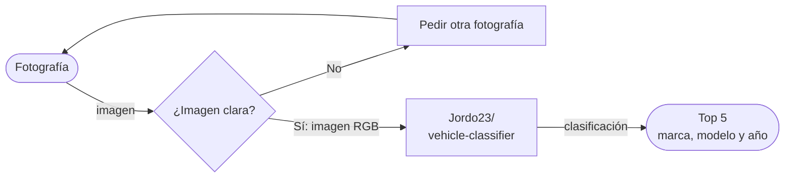
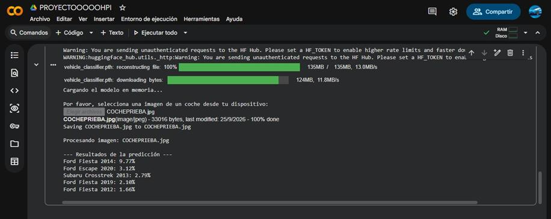

# Chesscar

> Proveedora de servicios de identificacion vehicular para administracion de seguros

**Proyecto integrador · Herramientas de IA**

**Grupo:** A **Equipo:** 1

## 👥 Integrantes

|Nombre completo|Matrícula|
|---|---|
|[Daniel Raymundo Juárez Domínguez]|
|[Erik Raúl Aguirre Moreno]|
|[Raúl Karim Chessani Carbajal]|
|[Cristopher Cortés Reynoso]|

## 1. Caso de uso

La necesidad que cumplimos es que a los talleres mecánicos o agencia de seguros o plataformas de seminuevos reciben muchas fotografías de vehículos y pierden mucho tiempo identificando manualmente los catálogos generaciones marcas modelos y años la solución que estamos proponiendo Es una herramienta digital automatizada que procese la imagen del auto y devuelva los datos técnicos de manera instantánea a la base de datos.

- **Entrada:** Imagenes de carros
- **Salida:** Un ranking de similitud

## 2. Modelo abierto elegido

|Dato|Respuesta|
|---|---|
|Identificador|[autor/modelo](https://www.google.com/url?q=https%3A%2F%2Fhuggingface.co%2FJordo23%2Fvehicle-classifier)|
|Tarea (pipeline tag)|`image-classification`|
|Número de parámetros|≈ 19M|
|Licencia|MIT License|
|Limitación o sesgo declarado|- Condiciones de imagen: Diseñado para fotos claras y bien iluminadas; decae en tomas ocluidas o con ángulos inusuales (cenitales, primeros planos extremos). - Cobertura: Presenta fallos con autos modificados/personalizados o modelos muy antiguos y raros ausentes en VMMRdb. - Alcance: No realiza detección de color de vehículo (debe procesarse aparte).|

## 3. Viabilidad de hardware

Memoria mínima=19M×2 bytes≈ 38MB

- **VRAM disponible en Colab:** 15+ GB ([nombre de la GPU])
- **Dónde se ejecuta:** Colab con GPU
- **Por qué:** debido a que sus servidores son gratuitos y provee la potencia de cálculo suficiente para realizar la inferencia visual sin saturar recursos locales.

## 4. Riesgo ético

- **Riesgo:** Lo que podría pasar de los riesgos son que si este tipo de tecnología se integra con cámaras de seguridad o públicas podría utilizarse para arrastrar los trayectos de personas sin su consentimiento y otro riesgo sería fallas de reconocimiento.
- **Mitigación:** Dirigido a solo clientes selectos de seguros

## 5. Evidencia

---

    