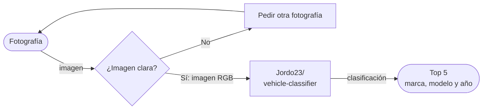
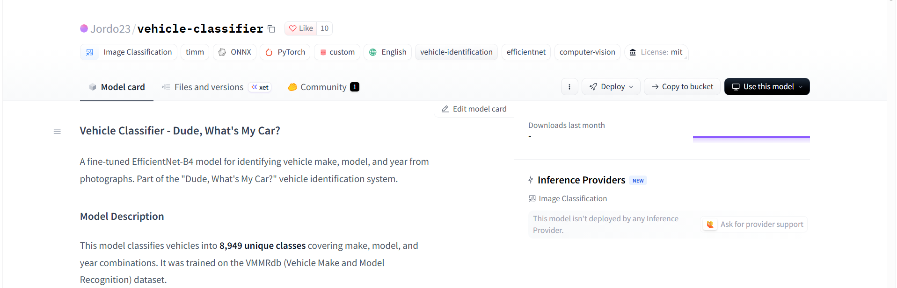
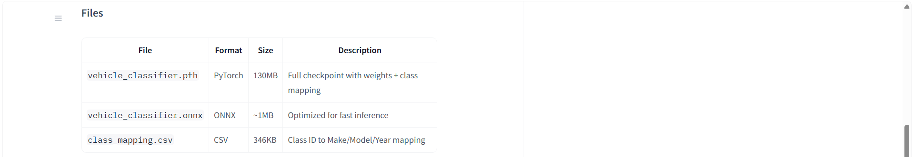

# Chesscar

> Proveedora de servicios de identificación vehicular para administración de seguros

**Proyecto integrador · Herramientas de IA**

**Grupo:** A · **Equipo:** 1

## 👥 Integrantes

| Nombre completo | Rol en el proyecto |
| --- | --- |
| Daniel Raymundo Juárez Domínguez | Implementación del modelo |
| Erik Raúl Aguirre Moreno | Búsqueda del modelo de IA |
| Raúl Karim Chessani Carbajal | Búsqueda de la necesidad |
| Cristopher Cortés Reynoso | Clasificación del modelo |

## 1. Caso de uso

La necesidad que cumplimos es que los talleres mecánicos, agencias de seguros o plataformas de seminuevos reciben muchas fotografías de vehículos y pierden mucho tiempo identificando manualmente en los catálogos las generaciones, marcas, modelos y años. La solución que proponemos es una herramienta digital automatizada que procese la imagen del auto y devuelva los datos técnicos de manera instantánea a la base de datos.

- **Entrada:** Imágenes de carros
- **Salida:** Un ranking de similitud (Top 5 de marca, modelo y año)

## 🔀 Cómo funciona

## 2. Modelo abierto elegido

| Dato | Respuesta |
| --- | --- |
| Identificador | [Jordo23/vehicle-classifier](https://huggingface.co/Jordo23/vehicle-classifier) |
| Tarea (pipeline tag) | `image-classification` |
| Número de parámetros | ≈ 19M |
| Licencia | MIT License |
| Limitación o sesgo declarado | - **Condiciones de imagen:** Diseñado para fotos claras y bien iluminadas; decae en tomas ocluidas o con ángulos inusuales (cenitales, primeros planos extremos). - **Cobertura:** Presenta fallos con autos modificados/personalizados o modelos muy antiguos y raros ausentes en VMMRdb. - **Alcance:** No realiza detección de color de vehículo (debe procesarse aparte). |

## 3. Viabilidad de hardware

$$
\text{Memoria mínima} = 19,000,000 \times 2\text{ bytes} = 38,000,000\text{ bytes} \approx 38\text{ MB}
$$

- **VRAM disponible en Colab:** 15+ GB (Tesla T4)
- **Dónde se ejecuta:** Colab con GPU
- **Por qué:** Debido a que sus servidores son gratuitos y proveen la potencia de cálculo suficiente para realizar la inferencia visual sin saturar recursos locales.

## 4. Riesgo ético

- **Riesgo:** Si este tipo de tecnología se integra con cámaras de seguridad o públicas podría utilizarse para rastrear los trayectos de personas sin su consentimiento, además del riesgo de fallas de reconocimiento.
- **Mitigación:** Dirigido únicamente a clientes selectos de aseguradoras en un entorno privado.

## 5. Evidencia

